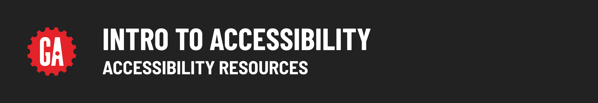

# 

**Learning objective:** By the end of this lesson, students will explore accessibility resources, such as the W3C, WAI, and Chrome accessibility tools.

Here are some final accessibility resources to help us make our sites and apps more accessibile.

## [World Wide Web Consortium (W3C)](https://www.w3.org/)

The World Wide Web Consortium (W3C) is an international community where member organizations, a full-time staff, and the public work together to develop Web standards. The W3C provides a variety of resources on web accessibility, including the WAI resources mentioned below.

The W3C also provides a number of other resources on web development, such as tutorials, specifications, and tools. These resources can help us to learn more about web development and how to create accessible web applications.

## [Web Accessibility Initiative (WAI)](https://www.w3.org/WAI/about/)

The Web Accessibility Initiative (WAI) is a part of the W3C that is dedicated to promoting web accessibility. The WAI provides a variety of resources, including the Web Content Accessibility Guidelines (WCAG), which are the most widely used accessibility standards.

The WAI also provides a variety of other resources, such as tutorials, checklists, and tools. These resources can help us to learn more about accessibility and how to make our software more accessible.

## [Lighthouse Accessibility checker for Chrome]((https://chrome.google.com/webstore/detail/lighthouse/blipmdconlkpinefehnmjammfjpmpbjk))

Lighthouse is a free Chrome extension that scans web pages for potential accessibility problems. It can identify a wide range of issues, such as missing alt text, low color contrast, and inaccessible form fields.

To use Lighthouse, simply install the extension and click the icon in the Chrome toolbar. It will then scan the current web page for accessibility problems.

Lighthouse will display a report of any problems it finds, along with the severity of the problem and instructions on how to fix it. You can use Lighthouse to scan your own web pages or the web pages of other websites. It's a great tool for identifying and fixing accessibility problems.

## [Microsoft's Inclusivity Guidelines](https://inclusive.microsoft.design/tools-and-activities/Inclusive101Guidebook.pdf)

This pdf is jam packed with info about inclusivity and accessibility in design, although some of the content doesn't apply to software engineering. 
