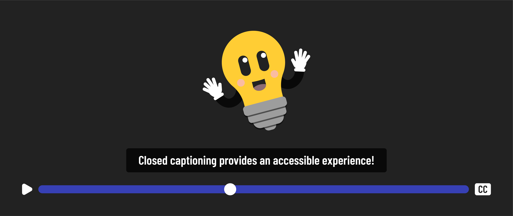

# 

**Learning objective:** By the end of this lesson, students will know what accessibility is, why it's important, and what disabilities it accommodates.

## What is accessibility?

Accessibility means making digital products and services accessible to everyone, including people with disabilities. It means designing and developing products and services to allow everyone to use them, regardless of their abilities.

To make content accessible we can accomidate people with visual, auditory, mobility, and cognitive disabilities. 

## Why is it important?

Accessibility is important because it allows everyone to participate fully in society. When digital products and services are not accessible, people with disabilities are excluded. This can significantly impact their lives, preventing them from accessing education, employment, and essential services.

Whether you know it or not, you've benefited from accessibility when using technology and digital products. Have you ever had to adjust the brightness on your phone when using it in bright sunlight or used a voice command to accomplish something on your phone or smart device? You can thank accessibility for those innovations! 

