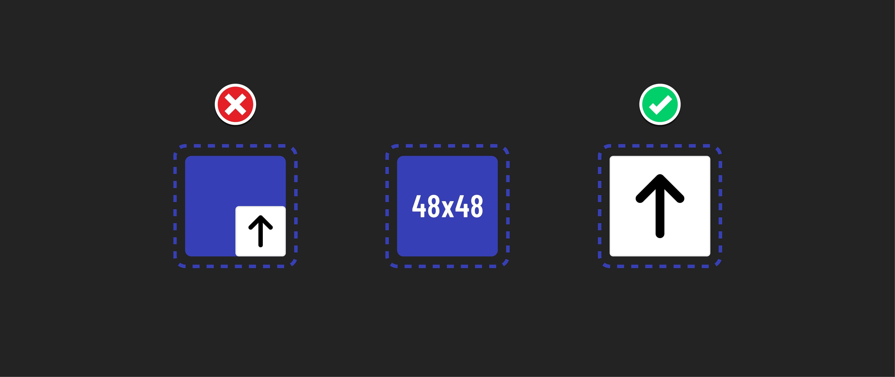

# 

**Learning objective:** By the end of this lesson, students will be familiar with the practices we can implement to provide accommodations to people with mobility disabilities.

## What are mobility disabilities?

Mobility accommodations can help people with arthritis, Parkinson's, MS, quadriplegia, paraplegia, and limb differences. Elderly users may also lack fine motor skills. These conditions have unique accessibility requirements and affect motor function to varying degrees.

## Accommodating mobility disabilities

We can accommodate mobility disabilities with accessibility with a few techniques:

- Provide keyboard navigation. This allows users to navigate our website or app using only a keyboard, ensuring they don't have to use a mouse or other pointing device. 
- Ensure buttons and links are large enough to be easily tapped with a finger or another pointing device. This is depicted above.
- Implement responsive design. This will ensure that our website looks good and functions well on all devices, regardless of screen size.
- Use clear and consistent labels for all interactive elements. This will help users understand what each element does and how to interact with it, regardless of how they interact with the website. This can even help people who need to interact with your site using voice commands.
- Minimize interactions where users need to click and drag items.

### Who this benefits

Beyond benefitting people with long-term mobility challenges, others can benefit from these accommodations as well:

- Those with short-term disabilities like repetitive strain injuries or a broken arm.
- Multitasking users with only one or no hands available to interact with their devices. The user may be carrying out other activities like holding a baby, cooking food, and so on.
