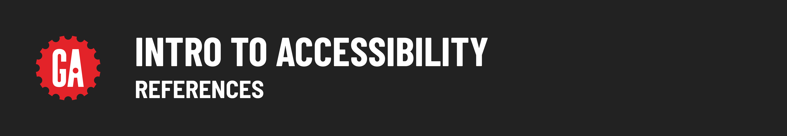

# [tktk Module Name] - References

## Lesson references

Links from lessons:

- [Four main accessibility principles](https://www.boia.org/blog/what-are-the-four-major-categories-of-accessibility)

- [WAVE Web Accessibility Evaluation Tool](https://wave.webaim.org/report#/https://www.boia.org/blog/what-are-the-four-major-categories-of-accessibility)

- [WebAIM contrast checker](https://webaim.org/resources/contrastchecker/)
- 
- [Google Chrome Lighthouse extension](https://chrome.google.com/webstore/detail/lighthouse/blipmdconlkpinefehnmjammfjpmpbjk)

- [Microsoft's Inclusivity Guidelines](https://inclusive.microsoft.design/tools-and-activities/Inclusive101Guidebook.pdf)

- [Writing Good Alt Text Video](https://www.youtube.com/watch?v=flf2vS0IoRs)