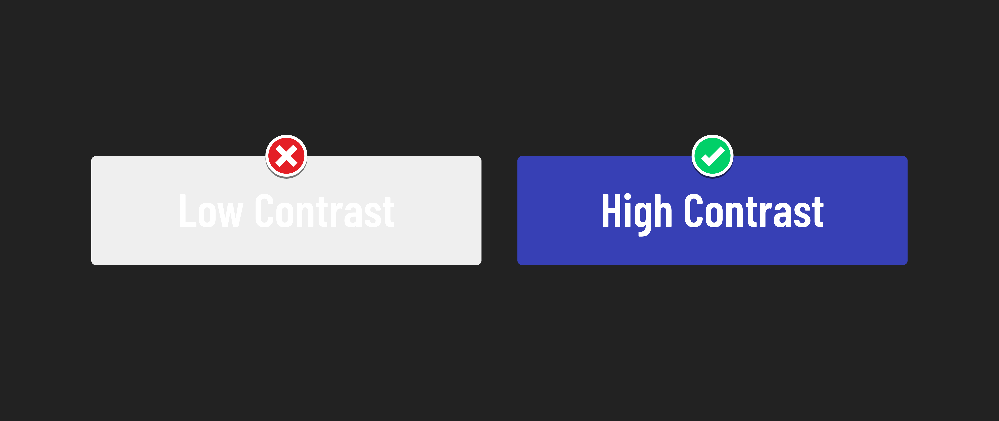

# 

**Learning objective:** By the end of this lesson students will be able to accommodate users with visual disabilities through the use of alternative text, color contrast, and non-color indicators.

## What are visual disabilities?

Visual disabilities can include blindness, low vision, and color blindness. People with visual disabilities may have difficulty seeing or distinguishing between colors.

## Accommodating visual disabilities

We can use these techniques to accommodate visual disabilities:

- Provide alt text for images so that people who use *screen readers* can understand what the images communicate.
- Use high-contrast colors between text and background to make text easier to read.
- Avoid the use of color alone to convey information.

> A ***screen reader*** is a software application that converts text and other elements on a digital screen into speech or Braille. Users of screen readers can range from people with varying degrees of visual impairment, including those who are completely blind, to individuals with learning disabilities like dyslexia that make processing text challenging. 

## Alt text

Alt text is a short image description that screen readers can parse. Providing alt text for all images, including decorative images such as logos or icons, is vital.


When an image can't be loaded you might see alt text like the example above. If the image was visible, it would presumably show a blue car.

Writing good alt text is difficult for many reasons, but primarily because alt text tries to capture what is important about an image in writing. However, the important elements in an image can change depending on the context in which the image is used. Sometimes, you won't know the context in which an image will be used; that's okay.

Although all of these won't apply in all conditions, here are some tips for writing good alt text:

- Be concise. The alt text should be as short as possible but still descriptive enough to convey the image's meaning.
- Avoid using words like image or photo. Screen readers will already announce that the content is an image.
- Be specific. If the image contains text, the alt text should include it if it is relevant to the context in which the image is presented.
- Be consistent. Use the same alt text for the same image wherever it appears on your website unless the context in which the image is used calls for deviation.
- Convey emotion. Is there an emotional meaning behind an image? Is something dramatic or exciting happening in an image? Your alt text should try to capture that emotion if it's relevant.

For more info, [this video from Google](https://www.youtube.com/watch?v=flf2vS0IoRs) does a great job explaining how to write good alt text.

### Who this benefits

This has benefits for visually impaired users but has benefits for others as well:

- Low bandwidth/low connectivity users. Sometimes, images may not load, and alt text can act as a placeholder.
- Users finding images through a search engine. Search engines use alt text to understand what an image is.

### How to add alt text to an image

You can add alt text to an image by adding the `alt` attribute inside of an `` element, as shown below:

```HTML

```

### 🧠 You Do


Write alt text for the above image without consideration to the context the image will be used in.

Consider the colors in the image, the people or objects present, the style of the image, and any other details you think might be relevant.

## Color contrast



Color contrast is the difference between the brightness of two colors. High color contrast makes text and images easier to read and comprehend. 

The [W3C](https://en.wikipedia.org/wiki/World_Wide_Web_Consortium) publishes the [Web Content Accessibility Guidelines (WCAG)](https://en.wikipedia.org/wiki/Web_Content_Accessibility_Guidelines), which companies and governments often reference to help them implement accessibility standards on the web. One of the areas they set standards for is color contrast.

### Who this benefits

Again, this has benefits for users who are visually impaired, but has benefits for others as well:

- People who are not visually impaired. Even users who are not visually impaired will find low-contrast visual elements difficult to read.
- People using devices outdoors. Sunlight makes many screens challenging to read. High contrast can help maintain visibility in the outdoors.
- People using low-quality displays. Monitors with truly high contrast are relatively modern and have not permeated the entire display market.

### WCAG color contrast requirements

WCAG 2.0 level AA (the easiest to meet requirement) specifies a minimum color contrast ratio of 4.5:1 for normal text and 3:1 for large text (24px or larger). There are many online tools to check the contrast between two colors. 

[This contrast checker](https://webaim.org/resources/contrastchecker/) built by WebAIM is one the most popular ways to compare the contrast directly between two colors. 

Both 
[Chrome](https://developer.chrome.com/docs/devtools/accessibility/contrast/) and [Firefox](https://firefox-source-docs.mozilla.org/devtools-user/accessibility_inspector/) have built-in tools to evaluate a website and flag any inaccessible text found on it as well.

There is a recurring theme when implementing accessible content: *simpler is almost always better*. Black text on a white background or white text on a black background will always meet these contrast requirements. That said, you're not restricted from doing something unique. Just ensure it meets the guidelines.

### 🧠 You Do

Add this HTML inside the `<body>`:

```html
<button id="btn">Click me!</button>
```

And this CSS to your CSS file:

```css
#btn {
  background-color: #EFEFEF;
  color: #FFFFFF;
  font-size: 20px;
  padding: 8px 16px;
}
```

Alter the CSS for the button to meet the WCAG 2.0 level AA color contrast requirements.  

If you don't have an eye for color, that's fine! Here are a few cool resources you can explore to help out:

- [Adobe Color](https://color.adobe.com/create/color-wheel)
- [Coolors](https://coolors.co/generate)
- [ColorSpace](https://mycolor.space/)

Don't forget you can also opt for a simpler color palette.

## Conveying meaning without color

Using color to highlight links or warnings is great, but it can't be the only way we show something's clickable or important. That's because not everyone sees colors the same way.

Consider the presentation of links, which traditionally feature distinct colors and are underlined. The underlining is especially beneficial for individuals with color vision differences, such as difficulty distinguishing between blue/black and purple/black, ensuring they can differentiate links from standard text.

Beyond this, underlined links are a widespread and clear pattern used across the internet. By adhering to this design, your users will immediately recognize how to navigate your site, even if they've never visited it.

### Who this benefits

Beyond benefitting visually impaired users, this also helps:

- People who are not visually impaired. Following established patterns helps all users find familiar landmarks in your application.
- People using devices outdoors or low-quality displays. Sunlight or bad display technology can make colors look washed out. Using signals beyond color increases the visibility of elements.
- A global audience. Cultural interpretations of color can vary, so using language other than color to communicate may be necessary for a site to be usable globally.
